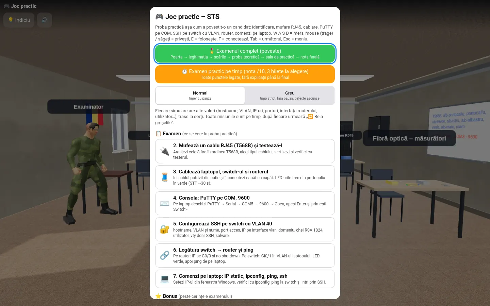
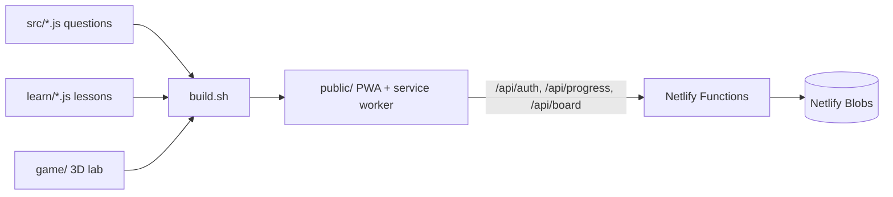
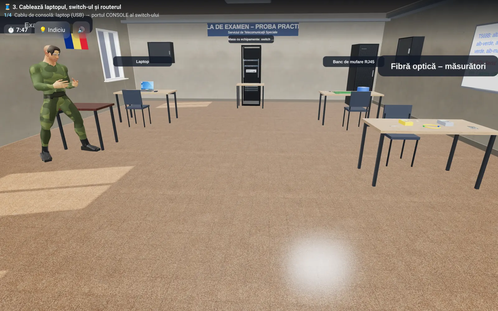
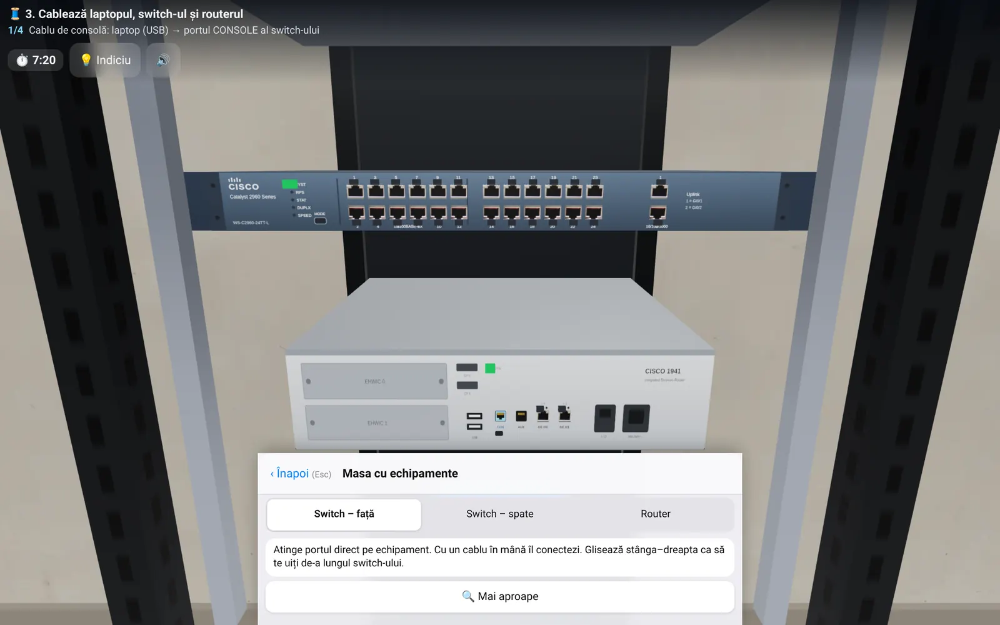
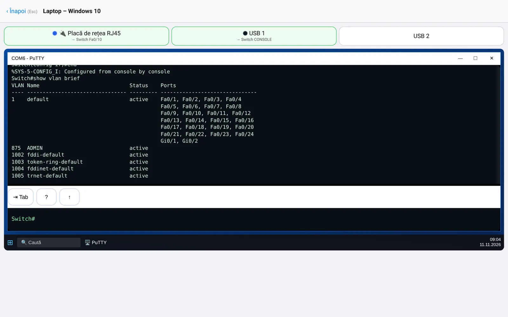
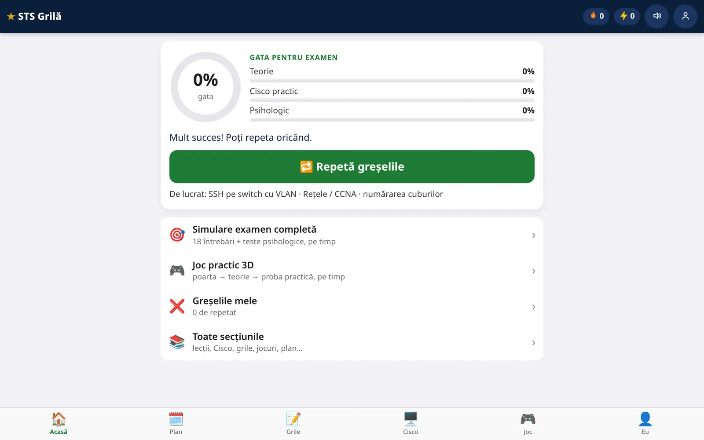

<div align="center">

<div style="font-size:64px">📡</div>

# STS Grilă

**Telecom & networking exam trainer: ~3,100 questions, lessons, games and a 3D practical lab — installable and offline.**

  <a href="https://sts-grila-ceusan3.netlify.app"></a>
  <a href="https://github.com/LucianCeusanRo/sts-grila/actions/workflows/ci.yml"></a>
  <a href="LICENSE"></a>
  
  <a href="https://github.com/LucianCeusanRo/sts-grila/stargazers"></a>
  <a href="https://github.com/LucianCeusanRo/sts-grila/commits/main"></a>

[English](#-about) · [Română](#-română)

</div>

<p align="center"></p>

<p align="center"><strong><a href="https://sts-grila-ceusan3.netlify.app">▶ Live demo</a></strong> — open it in the browser and try it yourself.</p>

## 📑 Table of contents

- [📖 About](#-about)
- [✨ Features](#-features)
- [🧠 How it works](#-how-it-works)
- [⚡ Quick start](#-quick-start)
- [📚 Step-by-step tutorial](#-step-by-step-tutorial)
- [🖼️ Screenshots](#-screenshots)
- [🔧 Configuration](#-configuration)
- [🗂️ Project structure](#-project-structure)
- [⚠️ Limitations](#-limitations)
- [❓ FAQ](#-faq)
- [🗺️ Roadmap](#-roadmap)
- [🤝 Contributing](#-contributing)
- [📄 License](#-license)
- [🇷🇴 Română](#-română)
- [👤 Author](#-author)

## 📖 About

A study app (installable PWA) for Romanian telecom and networking entrance exams. It combines a large multiple-choice question bank with lessons, mini-games and a browser-based 3D lab where you practise the hands-on part of the exam.

Live: https://sts-grila-ceusan3.netlify.app/

- **Used for:** daily practice for the written test (multiple-choice) *and* the practical test (crimping a cable, console into a switch, SSH, ping) of Romanian telecom / networking technician exams, on a phone or a laptop, even offline.
- **Helps:** candidates preparing for those exams, technical high-school students, and anyone starting with networking who learns better by doing than by reading.

## ✨ Features

- ✨ **Question bank:** ~3,100 questions in 23 categories (fiber optics, structured cabling, PCs, Windows, CCNA/ITN networking, VLAN & trunking, subnetting/VLSM, telephone cables, telecom measurements, electricity, antennas & radio, VoIP, aptitude tests, exam traps). Each question has an explanation.
- 🔎 **Lessons** with diagrams, plus a "Packet Tracer from zero" track.
- ⚙️ **Practice modes and games:** daily game with spaced repetition of mistakes, true/false swipe, quick-fire, matching pairs, put-in-order (T568B, SSH, VLAN, OSI, DHCP DORA…), complete-the-command, recognise-from-picture.
- 📊 **Mastery 0–5 per question** and "practise my mistakes" that brings each wrong question back in a different format.
- 🛡️ **3D practical lab (three.js):** RJ45 crimping (T568B) and testing, cabling laptop–switch–router, PuTTY console on COM at 9600, SSH on a switch with a VLAN, router link and ping, static IP / ipconfig on the laptop. Timed exam mode with randomised values, Normal/Hard difficulty and a final grade.
- 🧩 **Accounts and sync** through Netlify Functions + Netlify Blobs (progress, optional private leaderboard).
- 🌐 **Offline support** via a service worker.

## 🧠 How it works



The question bank, lessons and 3D lab are plain JavaScript sources concatenated by `build.sh` into a static PWA. Optional accounts (scrypt-hashed passwords, random session tokens) and progress sync run as Netlify Functions on Netlify Blobs.

**Tech stack:** Vanilla JavaScript, HTML/CSS, three.js (WebGL), PWA, Netlify Functions (Node.js), Netlify Blobs, Bash.

## ⚡ Quick start

```bash
git clone https://github.com/LucianCeusanRo/sts-grila.git && cd sts-grila
npm install && bash build.sh
npx serve public            # or: npx netlify dev  (with accounts & sync)
```

## 📚 Step-by-step tutorial

### 1. Install
```bash
git clone https://github.com/LucianCeusanRo/sts-grila.git && cd sts-grila
npm install            # only @netlify/blobs, used by the functions
```
### 2. Configure
No API keys or `.env` are needed. Accounts and progress use Netlify Blobs, which `netlify dev` emulates locally and Netlify provides automatically after deploy.
### 3. Build and run
```bash
bash build.sh          # concatenates src/*.js -> public/questions.js, learn/*.js -> public/lessons.js, builds the game
npx netlify dev        # serves public/ and netlify/functions locally
# or, without accounts/sync:
npx serve public
node check.js          # validates the question bank (4 answers each, no duplicates, explanation present)
```
Deploy: `npx netlify deploy --prod` (publish directory `public`, functions in `netlify/functions`, see `netlify.toml`).
### 4. Typical walkthrough
1. Open the app, pick a category (e.g. fiber optics or *Subnetting*) and answer a round; after each answer you see the explanation.
2. Wrong answers lower that question's mastery (0–5); *practise my mistakes* brings them back as true/false, matching or put-in-order.
3. Open a lesson (or *Packet Tracer from zero*) when a topic keeps coming back wrong.
4. Enter the 3D lab: crimp an RJ45 cable in T568B order, test it, cable laptop → switch → router, open PuTTY on COM at 9600, configure the switch and ping the router.
5. Switch the lab to timed exam mode (Normal or Hard) for a final grade with random values.
6. Optional: create an account to sync progress between phone and laptop.

## 🖼️ Screenshots

| | |
| --- | --- |
|  |  |
|  |  |

The question bank and lessons are written in Romanian.

## 🔧 Configuration

No API keys or `.env` are needed. Accounts use Netlify Blobs, emulated locally by `netlify dev` and provided automatically on Netlify.

## 🗂️ Project structure

```
src/        question bank sources (one file per category)
learn/      lesson sources
game/       3D lab / exam game sources (built by tools/buildgame.sh)
parts/      app modules (games, mastery, simulations, leaderboard)
public/     built static site (deployed)
netlify/functions/  auth.mjs, progress.mjs, board.mjs
tools/      generators for SVG diagrams and lessons
```

## ⚠️ Limitations

- Content is in Romanian only, written from public study material; it may contain mistakes and is not an official question bank — always check the current official syllabus.
- The Cisco CLI and PuTTY in the lab are simulations of the commands the exam needs, not a full IOS emulator.
- The 3D lab needs WebGL and is most comfortable on a laptop; on small phones it is cramped.
- Accounts are username + password only (no e-mail, no password recovery); sync needs Netlify (Functions + Blobs).

---

## ❓ FAQ

<details><summary><b>Is this the official exam question bank?</b></summary>

No. It is written from public study material and may contain mistakes; always check the current official syllabus.

</details>

<details><summary><b>Does it work offline?</b></summary>

Yes, after the first visit the service worker caches the app.

</details>

<details><summary><b>Is the Cisco CLI real?</b></summary>

It simulates the commands the practical exam needs; it is not a full IOS emulator.

</details>

<details><summary><b>How do I add questions?</b></summary>

Add them to the right file in `src/`, run `node check.js`, then `bash build.sh`.

</details>

## 🗺️ Roadmap

- [ ] English translation of the interface
- [ ] More practical-lab scenarios (fiber splicing, OTDR)
- [ ] Teacher mode with class statistics

## 🤝 Contributing

Question corrections are the most useful contribution: open an issue with the question, the correct answer and a source. Run `node check.js` before a PR.

## 📄 License

MIT — see [LICENSE](LICENSE).

## 🇷🇴 Română

<details>
<summary><b>Click pentru versiunea în limba română</b></summary>

Aplicație de studiu (PWA, se poate instala pe telefon) pentru examenele de admitere din telecomunicații și rețelistică. Combină o bancă mare de grile cu lecții, mini-jocuri și un laborator 3D direct în browser, unde exersezi proba practică.

Live: https://sts-grila-ceusan3.netlify.app/

#### Funcționalități
- **Banca de întrebări:** ~3.100 de grile în 23 de categorii (fibră optică, cablare structurată, PC, Windows, rețele CCNA/ITN, VLAN și trunk, subnetting/VLSM, cabluri telefonice, măsurători telecom, electricitate, antene și radio, VoIP, teste de aptitudini, capcane la examen), fiecare cu explicație.
- **Lecții** cu diagrame, plus traseul „Packet Tracer de la zero”.
- **Moduri de exersare și jocuri:** joc zilnic cu repetarea spațiată a greșelilor, Adevărat/Fals, Fulger, Perechi, Pune în ordine (T568B, SSH, VLAN, OSI, DHCP DORA…), Completează comanda, Recunoaște din poză.
- **Stăpânire 0–5 pe fiecare întrebare** și „Exersează greșelile”, care readuce fiecare întrebare greșită în alt format.
- **Laborator practic 3D (three.js):** mufare RJ45 (T568B) și testare, cablare laptop–switch–router, consolă PuTTY pe COM la 9600, SSH pe switch cu VLAN, legătură cu routerul și ping, IP static / ipconfig pe laptop. Mod examen pe timp, cu valori aleatoare, nivel Normal/Greu și notă finală.
- **Conturi și sincronizare** prin Netlify Functions + Netlify Blobs (progres, clasament privat opțional).
- **Funcționează offline** prin service worker.

#### La ce folosește și pe cine ajută
- **Folosește la:** exersare zilnică pentru proba scrisă (grile) *și* proba practică (mufare cablu, consolă pe switch, SSH, ping) la examenele pentru tehnician telecomunicații / rețele, pe telefon sau laptop, chiar și offline.
- **Ajută:** candidații la aceste examene, elevii de liceu tehnic și pe oricine începe cu rețelistica și învață mai bine făcând.

#### Arhitectură și tehnologii
Vezi diagrama de mai sus. JavaScript simplu, HTML/CSS, three.js (WebGL), PWA, Netlify Functions (Node.js), Netlify Blobs, script de build în Bash.

#### Tutorial
1. **Instalare:** `git clone …`, `npm install`.
2. **Configurare:** nu e nevoie de chei API sau `.env`; conturile folosesc Netlify Blobs (emulat local de `netlify dev`).
3. **Pornire:** `bash build.sh`, apoi `npx netlify dev` (sau fără conturi `npx serve public`); `node check.js` verifică banca de întrebări. Publicare: `npx netlify deploy --prod`.
4. **Utilizare:** alegi o categorie și răspunzi; vezi explicația după fiecare grilă; greșelile revin în „Exersează greșelile” în alt format; în laboratorul 3D mufezi RJ45 T568B, cablezi laptop → switch → router, deschizi PuTTY pe COM la 9600, configurezi switch-ul și dai ping; la final treci pe modul examen pe timp. Opțional îți faci cont ca să sincronizezi progresul.

#### Structura proiectului
`src/` (grile), `learn/` (lecții), `game/` (laborator 3D), `parts/` (module), `public/` (site generat), `netlify/functions/` (conturi, progres, clasament), `tools/` (generatoare).

#### Limitări
- Conținut doar în română, din materiale publice; poate conține greșeli și nu e o bancă oficială — verifică programa oficială în vigoare.
- CLI-ul Cisco și PuTTY sunt simulări ale comenzilor necesare la examen, nu un emulator IOS complet.
- Laboratorul 3D are nevoie de WebGL; e mai comod pe laptop.
- Conturile au doar utilizator + parolă (fără e-mail sau recuperare); sincronizarea cere Netlify.

</details>

## 👤 Author

**Lucian-Ciprian Ceușan** — telecom & network technician, Bucharest, Romania

[](https://lucian-ceusan.vercel.app) [](https://www.linkedin.com/in/lucian-ceusan-7a9179210) [](https://github.com/LucianCeusanRo)
